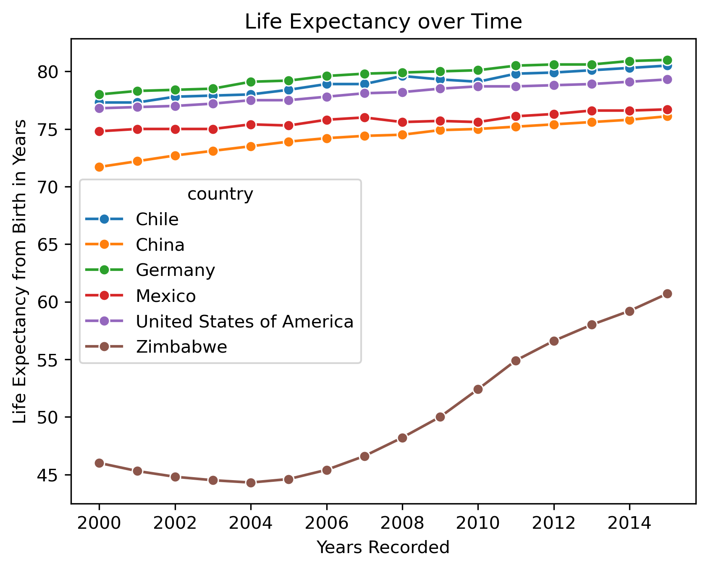
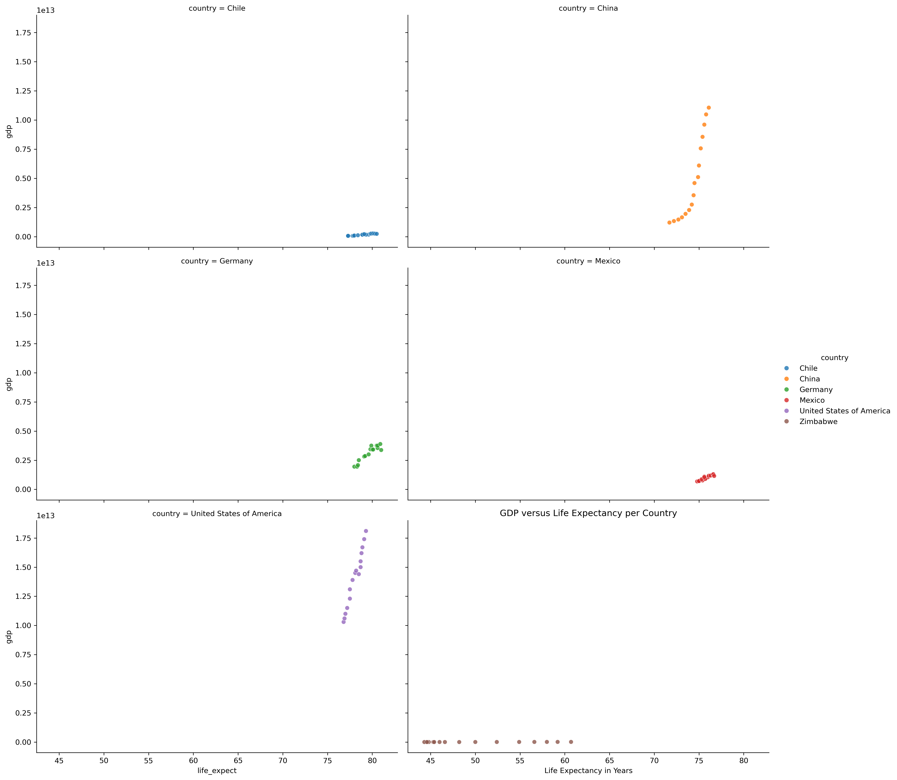

#Global Health and Economics Association Analysis (2000-2015)
An exploratory, independent data analysis investigating the historical association between Gross Domestic Product (GDP) and Life Expectancy at Birth across six different nations.

##Key Insights
1. **The Wealth Plateau:** While a positive association exists universally across the dataset, the *rate* of life expectancy growth slows or stabilizes after a certain country has reached a critical GDP threshold.
2. **The Outlier Case:** Zimbabwe exhibited a drop and subsequent 10(+?) year recovery in life expectancy, while their GDP didn't change significantly at all. This proves that while there is a positive association between GDP and life expectancy, that GDP isn't the only factor influencing it.
3. **The Dual Linear Surge:** China and the USA both displayed near perfect linear growth in GDP and life expectancy over the 15-year window. This opens up a new question of whether this was due simply to new opportunities, or because of the rival nations trying to out-do each other.

##Visualization Showcase 

*Figure 1. Comparative time-based analysis showing diverse national health trajectories.*

*Figure 2. The relationship between economic output and longevity.*

##Data Stack and Methodology
**Language:** Python
**Libraries:** Pandas (data manipulation), Seaborn, Matplotlib.pyplot (advanced data visualization), Scipy.stats (Pearson Correlation)
**Dataset:** Sourced from the World Health Organization (WHO) and the World Bank. Contains 96 observations spanning 6 countries (Chile, China, Germany, Mexico, USA, Zimbabwe) across 16 years.

##Questions Addressed
1. Has life expectancy increased over time in the six nations?
2. Has GDP increased over time in the six nations?
3. Is there a correlation between GDP and life expectancy of a country?
4. What is the average life expectancy in these nations, and what is the distribution?
